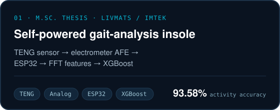
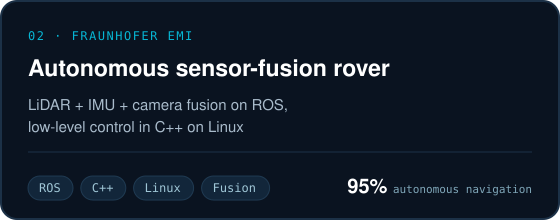
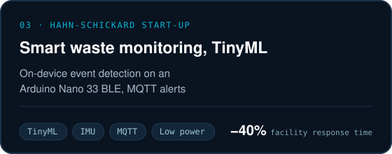
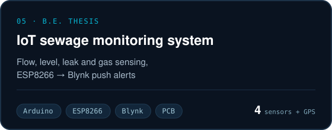

<p align="center">
  
</p>

<p align="center">
  <a href="https://ajeethv27.github.io"></a>
  <a href="https://www.linkedin.com/in/ajeethv"></a>
  <a href="mailto:ajeethvp@gmail.com"></a>
  <a href="https://ajeethv27.github.io/Ajeeth_Venkat_Prasat_Engineering_Portfolio.pdf"></a>
</p>

### Hi, I'm Ajeeth 👋

I build embedded systems that sit close to the physical world: sensors that produce awkward signals, the analog electronics that make those signals usable and the firmware + machine learning that turn them into decisions. I have three years of experience across industry (**Cognizant**) and applied research (**Fraunhofer EMI**, **livMatS**), and hold an M.Sc. in Embedded Systems Engineering from the **University of Freiburg**.

```c
struct Engineer ajeeth = {
    .role       = "Embedded Systems Engineer",
    .based_in   = "Freiburg, Germany",
    .focus      = { "biomedical wearables", "IoT edge devices",
                    "real-time signal processing", "edge AI / TinyML" },
    .latest     = "Self-powered TENG insole for gait analysis: 93.58 % accuracy",
    .languages  = { "English (C1)", "German (B1)", "Hindi (B2)", "Tamil" },
    .status     = OPEN_TO_EMBEDDED_ROLES,
};
```

---

### 🔬 Featured work

<table>
  <tr>
    <td width="50%"><a href="https://github.com/ajeethv27/teng-gait-wearable"></a></td>
    <td width="50%"><a href="https://ajeethv27.github.io/#rover"></a></td>
  </tr>
  <tr>
    <td width="50%"><a href="https://ajeethv27.github.io/#waste"></a></td>
    <td width="50%"><a href="https://github.com/ajeethv27/iot-sewage-monitoring"></a></td>
  </tr>
</table>

<details>
<summary><b>More about the flagship project: the TENG gait insole</b></summary>
<br>

A triboelectric nanogenerator (TENG) in the heel of a shoe insole turns every footstep into an electrical signal, so the sensor needs no battery. A custom **AD795 electrometer front-end** reads the GΩ-impedance source without loading it, an **ESP32** digitises it, and an **XGBoost** model on FFT features classifies standing, walking, running and jumping.

| Metric | Result |
|---|---|
| Accuracy (4 activities, 122,652 test windows) | **93.58 %** |
| Macro F1-score | **0.94** |
| Study | 12 participants · 84 recordings |
| TENG output | ≈ 800 mV open-circuit · 10.58 µW peak |

→ [Project write-up](https://github.com/ajeethv27/teng-gait-wearable) · [Analysis code](https://github.com/ajeethv27/Gait_Analysis_Project) · Paper under review at *IEEE Sensors Journal*
</details>

**Also built:** AI fall detection (IMU + LSTM for elderly care) · Automated car parking (CAN bus, Python, Raspberry Pi)

---

### 🧰 Toolbox

**Languages**<br>


**Embedded & systems**<br>


**AI / ML**<br>


**Hardware & protocols**<br>


**Tools**<br>


---

### 🧭 Path so far

| When | Role | Where |
|---|---|---|
| 2024 – 2025 | **Master's thesis:** biomedical wearable for rehabilitation | livMatS · University of Freiburg |
| 2024 | **Student research assistant:** robotics & sensor systems | Fraunhofer EMI, Freiburg |
| 2023 – 2024 | **Start-up project:** TinyML smart waste monitoring | Hahn-Schickard / Uni Freiburg |
| 2022 – 2026 | **M.Sc. Embedded Systems Engineering** | University of Freiburg |
| 2021 – 2022 | **Software engineer:** test automation & healthcare analytics | Cognizant, Bengaluru |
| 2019 | **Graduate innovation engineer:** IoT energy monitoring | Forge Innovation & Ventures |
| 2017 – 2021 | **B.E. Electrical & Electronics Engineering** | Anna University (Kumaraguru College of Technology) |

### 📄 Publications

- **Intelligent Biomedical Wearable for Gait Analysis in Rehabilitation**, *IEEE Sensors Journal* (under review)
- **Energy Management System for Smart Factories**, *IRJET*, Vol. 7, Issue 9, 2020, pp. 3390–3393

---

<p align="center">
  <sub>Open to embedded systems roles in Germany. The quickest way to reach me is <a href="mailto:ajeethvp@gmail.com">email</a> or <a href="https://www.linkedin.com/in/ajeethv">LinkedIn</a>.</sub>
</p>
